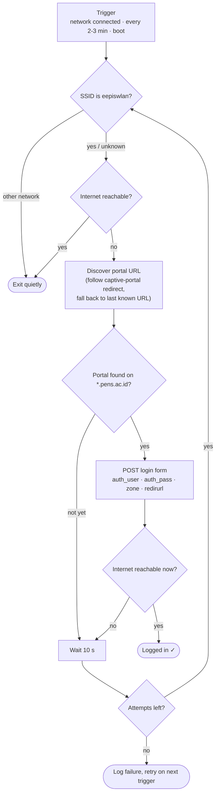

<div align="center">

# campus-wifi-autologin

**Automatic login for the PENS campus Wi-Fi (`eepiswlan`) captive portal.**
Connect to the network and you are online. No browser, no typing your NetID every morning.

[](https://github.com/Kenshin517/campus-wifi-autologin/actions/workflows/ci.yml)
[](LICENSE)


</div>

---

## Contents

- [Features](#features)
- [Quick start](#quick-start)
  - [Windows](#windows)
  - [Linux](#linux)
- [Usage](#usage)
- [How it works](#how-it-works)
- [Configuration](#configuration)
- [Troubleshooting](#troubleshooting)
- [Security](#security)
- [Uninstall](#uninstall)
- [Project layout](#project-layout)
- [Contributing](#contributing) · [License](#license) · [Disclaimer](#disclaimer)

## Features

- **Hands-free login** whenever you join `eepiswlan`; other networks (home Wi-Fi, hotspots) are ignored.
- **Reliable on a slow network.** Right after Wi-Fi connects, DHCP, DNS or the portal are often not ready yet. Each run retries up to 6 times instead of giving up after one try.
- **Self-healing.** Besides reacting to "network connected" events, it re-checks every few minutes, so a session dropped by the portal (idle timeout, nightly reset) is restored automatically.
- **No hardcoded portal address.** The portal host differs per access point (`iac3`, `iac32`, ...). It is discovered from the captive-portal redirect, with the last known address as a fallback.
- **Credentials stay private.** Stored outside the repository, readable only by the system account, never written to logs or visible in the process list.
- **Stops on a wrong password** instead of hammering the portal.

## Quick start

### Windows

Requirements: Windows 10 or 11 and an Administrator account (needed once, to register the background task).

**Option A: download ZIP**

1. Click **Code → Download ZIP** on this page and extract it.
2. Open the `windows` folder and double-click **`install.bat`**.
3. Click **Yes** on the Administrator prompt, then enter your NetID and password (the password is hidden while typing).

**Option B: git**

```powershell
git clone https://github.com/Kenshin517/campus-wifi-autologin.git
cd campus-wifi-autologin\windows
.\install.bat
```

That's it. The installer copies everything it needs to `C:\ProgramData\CampusWifiAutologin`, so you can delete the downloaded folder afterwards.

> If SmartScreen shows *"Windows protected your PC"*, choose **More info → Run anyway**. This is normal for a newly downloaded `.bat` file.

<details>
<summary>Upgrading from v1 (<code>JALANKAN.bat</code>)?</summary>

Just run the new `windows\install.bat`. It removes the old *Auto Login Wifi Kampus* task automatically. You can then delete the old folder, including its `config.ps1`.
</details>

### Linux

Requirements: systemd (or cron), `curl`, and preferably NetworkManager. Tested on Debian/Ubuntu-based distributions.

**Option A: `.deb` package (Debian, Ubuntu, Mint, Pop!_OS, ...)**

```bash
sudo apt install ./campus-wifi-autologin_2.0.1_all.deb
```

You are asked for your NetID and password during installation. Build the package yourself with `linux/build-deb.sh` (output goes to `dist/`).

**Option B: from source (any distribution)**

```bash
git clone https://github.com/Kenshin517/campus-wifi-autologin.git
cd campus-wifi-autologin/linux
sudo ./install.sh
```

## Usage

After installation there is nothing to do: connect to `eepiswlan` and you are online within a few seconds.

**Windows**

| Task | How |
| --- | --- |
| Change NetID / password | Run `windows\install.bat` again |
| View the log | `notepad C:\ProgramData\CampusWifiAutologin\autologin.log` |
| Run a check now | `schtasks /run /tn CampusWifiAutologin` (as Administrator) |
| Uninstall | Run `windows\uninstall.bat` |

**Linux**

| Task | Command |
| --- | --- |
| Show status and recent log | `campus-wifi-autologin status` |
| Change NetID / password | `sudo campus-wifi-autologin setup` (or `sudo dpkg-reconfigure campus-wifi-autologin`) |
| Run a check now | `sudo campus-wifi-autologin run` |
| Follow the log | `campus-wifi-autologin logs` |
| systemd journal | `journalctl -u campus-wifi-autologin` |

## How it works



The campus portal is served over HTTPS on port `8003` of a `*.pens.ac.id` host (for example `https://iac3.pens.ac.id:8003`). Because the exact host depends on the access point, the tool requests a plain-HTTP page (such as `http://neverssl.com`), lets the portal redirect it, and uses whatever login URL the portal returns.

| | Windows | Linux |
| --- | --- | --- |
| Runtime | Windows PowerShell 5.1 (built in) | Bash + curl |
| Triggers | Task Scheduler as `SYSTEM`: boot, network-connected event (NetworkProfile 10000), every 3 min | NetworkManager dispatcher hook, systemd timer every 2 min (cron fallback) |
| SSID detection | `netsh wlan`, falls back to the network profile name | `nmcli`, `iwgetid` or `iw` |
| Credential storage | `config.json`, password encrypted with DPAPI (machine scope), ACL: SYSTEM + Administrators | `/etc/campus-wifi-autologin/config`, mode `600 root:root` |
| Log | `C:\ProgramData\CampusWifiAutologin\autologin.log` | `/var/log/campus-wifi-autologin/autologin.log` |

Routine checks (already online, not on campus) are not logged, so the log only shows real login activity.

## Configuration

Defaults work for PENS. Advanced settings live next to the credentials:

| Setting | Default | Meaning |
| --- | --- | --- |
| `TargetSsid` / `TARGET_SSID` | `eepiswlan` | Network to act on |
| `PortalDomain` / `PORTAL_DOMAIN` | `pens.ac.id` | Only portals under this domain receive your credentials |
| `MaxAttempts` / `MAX_ATTEMPTS` | `6` | Login attempts per run |
| `RetryDelay` / `RETRY_DELAY` | `10` | Seconds between attempts |
| `VERBOSE` (Linux) | `0` | `1` also logs routine checks |

Windows: `C:\ProgramData\CampusWifiAutologin\config.json` (edit as Administrator).
Linux: `/etc/campus-wifi-autologin/config` (edit with `sudo`).

## Troubleshooting

Start with the log (see [Usage](#usage)). Typical messages:

| Log message | Meaning / fix |
| --- | --- |
| `captive portal not found yet` | Normal for the first seconds after connecting; the tool retries. If every attempt says this, the portal did not redirect. Open any `http://` site in a browser to confirm the portal is up. |
| `Portal rejected the login twice` | Wrong NetID or password. Re-run the installer (Windows) or `sudo campus-wifi-autologin setup` (Linux). |
| `FAILED after 6 attempts` | The portal was reachable but login did not give internet access. It is retried automatically at the next trigger; if it keeps happening, open an [issue](https://github.com/Kenshin517/campus-wifi-autologin/issues) with the log. |
| Nothing is logged at all | You are already online or not on `eepiswlan`. That is expected. |

**Testing from a logged-out state.** The portal remembers sessions per MAC address on the server, so reconnecting does not log you out. To test, enable *Random hardware addresses* for `eepiswlan` (Windows: Settings → Network → Wi-Fi) or set `wifi.cloned-mac-address=random` in NetworkManager, then reconnect.

**Windows 11 24H2 and later.** `netsh wlan` may need Location permission to report the SSID. The tool then falls back to the network profile name and to checking that the portal is a `pens.ac.id` host, so it keeps working without Location enabled.

## Security

- Credentials are **never stored in the repository**. They are entered at install time and saved in a system location only privileged accounts can read.
- On Windows the password is additionally encrypted with DPAPI; the ciphertext is useless on another machine.
- On Linux the password is passed to `curl` through a private temporary file, so it never appears in `ps` output. The `.deb` removes it from the debconf database right after installation.
- TLS certificate errors are tolerated **only** for hosts under `PortalDomain` (the portal uses an internal certificate); every other host is validated normally.
- The background job only sends your credentials to a URL under `PortalDomain`.

Found a security problem? Please open an issue without sensitive details, or contact the maintainer directly.

## Uninstall

**Windows:** double-click `windows\uninstall.bat`. This removes the scheduled task and `C:\ProgramData\CampusWifiAutologin`, including your saved credentials.

**Linux (.deb):**

```bash
sudo apt remove campus-wifi-autologin   # keep credentials
sudo apt purge  campus-wifi-autologin   # also delete credentials and log
```

**Linux (source):** `sudo ./uninstall.sh` (add `--purge` to delete credentials and log).

## Project layout

```
campus-wifi-autologin/
├── windows/
│   ├── install.bat                   # double-click to install / reconfigure
│   ├── uninstall.bat                 # double-click to remove
│   ├── Install.ps1                   # installer (credentials, ACLs, scheduled task)
│   ├── Uninstall.ps1
│   └── CampusWifiAutologin.ps1       # the login script run by Task Scheduler
├── linux/
│   ├── bin/campus-wifi-autologin     # CLI: run | setup | status | logs
│   ├── systemd/                      # service + 2-minute timer
│   ├── networkmanager/               # dispatcher hook (instant trigger on connect)
│   ├── debian/                       # .deb maintainer scripts and debconf templates
│   ├── install.sh / uninstall.sh     # install from source
│   └── build-deb.sh                  # builds dist/campus-wifi-autologin_<ver>_all.deb
├── .github/workflows/ci.yml          # ShellCheck, .deb install test, PSScriptAnalyzer
├── CHANGELOG.md
├── CONTRIBUTING.md
└── LICENSE
```

## Contributing

Bug reports and pull requests are welcome. See [CONTRIBUTING.md](CONTRIBUTING.md).

## License

[MIT](LICENSE) © 2026 Sandy Aprilando

## Disclaimer

This is an unofficial student project and is not affiliated with Politeknik Elektronika Negeri Surabaya. It only automates what you would otherwise type into the login page, using **your own** valid account. Use it in accordance with the campus network policy.
